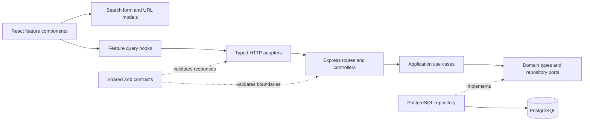

# Architecture guide

IDX Exchange is a read-only property browser built as a TypeScript PERN monorepo. It has one web app, one API, and one PostgreSQL database. Business modules provide a clear place to grow without introducing separate services.

- [Product scope and audience](../product/PRD.md)
- [ERD and data dictionary](data-model.md)
- [Architecture decisions](decisions.md)
- [Testing and coverage](testing.md)
- [Setup, API and Vercel/Neon deployment](../README.md)

## Dependency direction

Controllers translate HTTP into use-case calls. The application layer depends on repository interfaces, and module composition supplies PostgreSQL implementations. Domain/application code cannot import Express, Zod, Drizzle, or platform adapters; `npm run check:boundaries` enforces this rule. `asyncHandler` forwards rejected controller promises to the central HTTP error handler.

React is the view in the project's MVC interpretation. The API does not render templates. Application use cases and domain types form the business model, while persistence mapping stays in infrastructure.

## A search through the UI

1. `useListingSearch` parses the URL with the pure `model/search-query.ts` schema. Known repeated or invalid values fail before a request is sent.
2. `ListingSearchBar` holds a location draft independently of the applied URL. Search/Enter commits it. Five-digit ZIPs and ZIP+4 values remain strings; other text is interpreted as a city.
3. `PropertyFilters` validates a local form draft. Desktop sidebar Apply commits refinements; the phone sheet commits location, refinements, and sorting together. Cancel discards its draft.
4. `useListings` keys TanStack Query by the normalized search. The HTTP adapter validates the returned DTO with shared contracts. In-flight work is cancellable.
5. The API validates input again, then invokes a use case. The repository uses parameterized filters and an allowlisted sort column, with ascending UUIDs as the tie-breaker and nulls last.
6. Count and page are read in one PostgreSQL repeatable-read transaction. The results header uses the API's total, while the range near desktop pagination uses the current page.

An immediate desktop sort preserves the unsent location draft. While a new query is pending, the heading does not present the old total as belonging to the new location. Pagination is disabled for placeholder data, failed requests, and unavailable result pages.

## Navigation and overlays

Property cards are native React Router links. Their state records the originating search URL; browser history and the detail return action restore it. `usePageScroll` restores positions by history entry once content is ready. Sorting can preserve scroll, while a new search starts at the top. These positions are transient UI state, not database records.

The shared native `dialog` wrapper manages modal focus, Escape, background scroll locking and focus return. The gallery uses native horizontal scroll snapping, numeric counters and bounded previous/next navigation. Phone photo controls and Close belong at the bottom; desktop controls remain beside the image and in its header. There is no autoplay or decorative scroll animation.

Theme preference belongs to browser storage. CSS tokens style the same mounted view, so switching appearance does not recreate the search or reset the gallery. The initial theme follows the system until a user makes an explicit choice.

## Deployment boundary

Vercel builds the frontend and API as separate projects from the same repository. Only the API receives database credentials. `VITE_API_BASE_URL` is public browser configuration; CORS permits the configured frontend origins. Neon hosts PostgreSQL, and migrations are an explicit release step rather than a request-time operation.

The import bridge is a separate local tool, not a scheduled live MLS sync. Raw source payloads remain private database fields and are never selected into listing DTOs.
