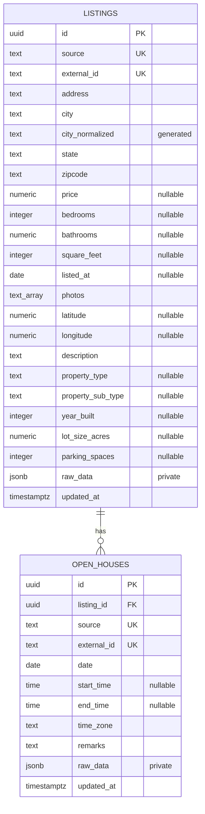

# ERD and data dictionary

Source of truth: [Drizzle schema](../backend/src/platform/db/schema.ts) and [versioned migrations](../backend/db/migrations/).

`UK` on source/external ID denotes a **composite** unique constraint in each table, not uniqueness of either column alone. Every open house belongs to one listing. A listing can have zero or many open houses; the foreign key uses `ON DELETE CASCADE`.

## Listings

| Fields                                | PostgreSQL representation                | Meaning                                                                          |
| ------------------------------------- | ---------------------------------------- | -------------------------------------------------------------------------------- |
| `id`                                  | UUID, generated primary key              | Stable internal identity used by detail URLs and foreign keys.                   |
| `source`, `external_id`               | Nonempty text, composite unique          | Source identity for idempotent imports. An MLS ID is not the internal UUID.      |
| `address`, `city`, `state`, `zipcode` | Non-null text, default empty             | Empty means unavailable. ZIP stays text to preserve leading zeroes and ZIP+4.    |
| `city_normalized`                     | Generated text                           | `lower(btrim(city))`, supporting case-insensitive exact city lookup.             |
| `price`                               | Nullable numeric(14,2), nonnegative      | Price in USD; null is unknown, not zero.                                         |
| `bedrooms`                            | Nullable nonnegative integer             | Zero may represent a studio; null is unavailable.                                |
| `bathrooms`                           | Nullable numeric(5,1), nonnegative       | Fractional bathrooms such as 2.5.                                                |
| `square_feet`                         | Nullable nonnegative integer             | Living area in square feet. Price/sqft requires a positive price and area.       |
| `listed_at`                           | Nullable date                            | Calendar listing date, not a UTC timestamp.                                      |
| `photos`                              | Non-null text array, default empty       | Ordered public image URLs. An empty list or failed image gets a UI fallback.     |
| `latitude`, `longitude`               | Nullable numeric(18,15) / numeric(19,15) | Ranges -90..90 and -180..180. A map requires both.                               |
| `description`                         | Non-null text, default empty             | Displayed as text, not injected HTML.                                            |
| `property_type`, `property_sub_type`  | Nullable text                            | Canonical property classifications.                                              |
| `year_built`                          | Nullable integer, 1..9999                | Construction year when supplied.                                                 |
| `lot_size_acres`                      | Nullable numeric(14,4), nonnegative      | Lot size in acres.                                                               |
| `parking_spaces`                      | Nullable nonnegative integer             | Parking count when supplied.                                                     |
| `raw_data`                            | Non-null JSONB                           | Original source material for import diagnostics; excluded from the public API.   |
| `updated_at`                          | Timestamp with timezone                  | Persistence/import update time; not an assertion of current market availability. |

## Open houses

| Fields                   | Representation                  | Meaning                                                                         |
| ------------------------ | ------------------------------- | ------------------------------------------------------------------------------- |
| `id`, `listing_id`       | UUID primary / foreign key      | Internal event identity and its parent listing.                                 |
| `source`, `external_id`  | Nonempty text, composite unique | Idempotent source identity.                                                     |
| `date`                   | Required date                   | Event calendar date at the property.                                            |
| `start_time`, `end_time` | Nullable time without timezone  | Local wall-clock values; missing times remain unavailable.                      |
| `time_zone`              | Required nonempty text          | IANA zone supplied by seed/import configuration, such as `America/Los_Angeles`. |
| `remarks`                | Non-null text, default empty    | Event notes.                                                                    |
| `raw_data`, `updated_at` | JSONB / timestamptz             | Private source material and persistence update time.                            |

The client compares the event date and known end time against the current date/time **in the event's zone**. Past events remain readable as recorded schedules. Unknown timezone data does not become an invented upcoming event.

## Indexes and query behavior

- Unique `(source, external_id)` on both tables supports repeatable upserts.
- Listing indexes cover normalized city, ZIP, `(price, id)` and `(listed_at, id)`.
- Open houses use `(listing_id, date, start_time, id)` for deterministic detail queries.
- Other allowed sort fields remain allowlisted. Additional indexes should follow measured query plans rather than being added for every field.
- Offset pagination is bounded and ordered consistently. A count/page transaction prevents disagreement during concurrent imports, but separate page requests are not a frozen inventory snapshot.

All runtime API operations are read-only. Seed/import scripts own writes. Migration history lives in `_idx_migrations`; it is operational metadata rather than a product entity. Data dumps, credentials, and generated import reports do not belong in Git.
