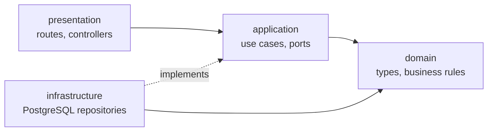

# Architecture

## Overview

IDX Exchange is a TypeScript monorepo with three npm workspaces:

| Workspace            | Package          | Role                                                                |
| -------------------- | ---------------- | ------------------------------------------------------------------- |
| `frontend/`          | `@idx/web`       | React single-page app built with Vite                               |
| `backend/`           | `@idx/api`       | Express API, migrations, seed and import scripts                    |
| `packages/contracts` | `@idx/contracts` | Zod schemas and TypeScript types for requests, responses and errors |

At runtime there is one web app, one API and one PostgreSQL database. The web app and the API are
deployed as separate Vercel projects; only the API holds database credentials.

```mermaid
flowchart LR
    Browser[React web app] -- HTTPS /api/v1 --> API[Express API]
    API --> DB[(PostgreSQL)]
    Contracts[@idx/contracts] -. validates requests .-> API
    Contracts -. validates responses .-> Browser
```

The API is a **modular monolith**: business capabilities live in separate modules
(`listings`, `open-houses`) inside one deployable service. This keeps boundaries explicit
without the operational cost of separate services.

## Layers and the dependency rule

Each backend module follows the same four layers. Dependencies point inward only.



| Layer            | Contains                                                      | May depend on                                        |
| ---------------- | ------------------------------------------------------------- | ---------------------------------------------------- |
| `domain`         | Business types and pure rules (`Listing`, `classifyHomeType`) | Its own domain, `shared`                             |
| `application`    | Use cases and the repository interfaces (ports) they need     | Its own domain and application, `shared`             |
| `infrastructure` | Drizzle repositories implementing the ports                   | Its module's domain and application, `platform/db`   |
| `presentation`   | Express routes and controllers                                | Its module's application, `platform/http`, contracts |

Outside the modules:

- `platform/` holds framework adapters shared by modules: configuration, database client and
  schema, HTTP middleware and logging. Platform code never imports a module.
- `shared/` holds framework-independent code, currently `ApplicationError`.
- Each module's `index.ts` wires its use cases, controller and router. `app.ts` is the
  composition root: it reads the environment, creates the database client and the repositories,
  and passes them to `createApp`.

Modules do not import each other. `open-houses` must reject unknown listings, so it declares its
own narrow port, `ListingExistenceLookup.exists(id)`. The composition root satisfies it with the
listings repository.

MVC maps onto these layers as follows: the **model** is the domain and application code, the
**controller** is the presentation layer, and the **view** is the React app consuming JSON. The
API renders no templates.

## Request pipeline

```
request
  → requestContext   assigns X-Request-ID, logs method, path, status and duration
  → cors             allows configured origins; GET, HEAD and OPTIONS only
  → express.json     32 KB limit
  → module router    e.g. GET /api/v1/listings
      → validateRequest(source, schema)   Zod contract; parsed values go to res.locals
      → controller (asyncHandler)         calls one use case, returns JSON
          → use case                      business rules, calls a port
              → repository                parameterized Drizzle query, maps rows to domain types
  → notFoundHandler  unknown routes become ROUTE_NOT_FOUND
  → errorHandler     maps any error to a status and the standard error body
```

- Express's query parser is set to `simple`, so nested objects cannot be smuggled through query
  strings. Validated values are read from `res.locals`, never from `req.query`.
- `/api/health/live` checks only the process. `/api/health` also runs `SELECT 1` and returns
  `503` when the database is unreachable.
- `/api/openapi.json` is generated at runtime from the same Zod contracts.

## Error handling

Controllers contain no `try/catch`. Every controller is wrapped by
[`asyncHandler`](../backend/src/platform/http/async-handler.ts), which forwards a rejected promise
to [`errorHandler`](../backend/src/platform/http/error-handler.ts).

| Error source                               | Status    | Code                                                                               |
| ------------------------------------------ | --------- | ---------------------------------------------------------------------------------- |
| `HttpError` (validation, CORS, 404 route)  | As thrown | `VALIDATION_ERROR`, `ORIGIN_NOT_ALLOWED`, `ROUTE_NOT_FOUND`, `SERVICE_UNAVAILABLE` |
| `ApplicationError` of kind `not-found`     | 404       | Module code, e.g. `LISTING_NOT_FOUND`                                              |
| `ApplicationError` of kind `invalid-input` | 400       | Module code, e.g. `INVALID_SEARCH_RANGE`                                           |
| Malformed URL encoding                     | 400       | `INVALID_PATH`                                                                     |
| Invalid or oversized JSON body             | 400 / 413 | `INVALID_JSON`, `PAYLOAD_TOO_LARGE`                                                |
| Anything else                              | 500       | `INTERNAL_ERROR`                                                                   |

Use cases throw `ApplicationError(kind, code, message)`. The module owns the code; the HTTP
adapter owns the status, chosen from the kind. Adding a business error therefore needs no change
in `platform/`.

For `500` responses the client receives a generic message. The log records the request ID, code
and error class only, never the error message, SQL or connection details.

`try/catch` remains only where cleanup or a local fallback is required: rolling back a migration
transaction, CLI scripts that must exit with a status code, browser storage access, and time zone
formatting.

## Data access

- Repositories select public columns explicitly. `raw_data` is never selected for the API.
- Filters are built from Drizzle operators with bound parameters. Sort columns come from a fixed
  map, and the direction is one of two fixed SQL fragments.
- The search count and page run in one `REPEATABLE READ`, read-only transaction, so the total and
  the page agree.
- Numeric columns (`numeric`) are returned by `pg` as strings and converted to numbers in the
  repository mapper. Dates stay `YYYY-MM-DD` strings to avoid time zone shifts.
- The pool is small (5 connections) with connection, statement (15 s) and query (20 s) timeouts.
  On Vercel, `attachDatabasePool` lets the platform release idle connections.

Schema details: [Database (ERD)](erd.md).

## Security model

| Concern             | Measure                                                                                                                                                                                                                        |
| ------------------- | ------------------------------------------------------------------------------------------------------------------------------------------------------------------------------------------------------------------------------ |
| Write access        | The HTTP API exposes `GET` routes only. Writes happen only through migration, seed and import scripts run by an operator.                                                                                                      |
| Injection           | Bound parameters for every value; allowlisted sort columns; `LIKE` metacharacters escaped in city suggestions.                                                                                                                 |
| Input validation    | Strict Zod schemas reject unknown keys, repeated parameters, non-finite numbers and out-of-range values. IDs must be UUIDs.                                                                                                    |
| Cross-origin access | CORS allows only the exact origins in `FRONTEND_ORIGINS`.                                                                                                                                                                      |
| Secrets             | `DATABASE_URL` exists only in the API environment. `VITE_*` variables are public by design and hold only the API origin and an optional restricted Maps key. Environment validation errors name the variable, never its value. |
| Data exposure       | Raw source records stay in the database. Error responses and logs exclude SQL and credentials.                                                                                                                                 |
| Response integrity  | The browser validates every API response against the shared contract before rendering it.                                                                                                                                      |
| Browser hardening   | `X-Powered-By` is disabled; external links use `rel="noopener noreferrer"`; descriptions render as text, never as HTML.                                                                                                        |

## Frontend

```
app/        router, layout, providers (QueryClient)
pages/      route components; compose features through their public index
features/
  listings/     api/  hooks/  model/  components/  index.ts
  open-houses/  api/  hooks/  model/  components/  index.ts
shared/     api client, config, hooks, ui, utils
```

| Folder                  | Responsibility                                                      | Must not depend on         |
| ----------------------- | ------------------------------------------------------------------- | -------------------------- |
| `features/*/model`      | Pure rules: URL parsing, form conversion, sort labels, event status | React, HTTP, hooks         |
| `features/*/api`        | One function per endpoint; returns contract-validated data          | React, hooks, components   |
| `features/*/hooks`      | TanStack Query hooks and URL state                                  | The feature's components   |
| `features/*/components` | Rendering and interaction                                           | Other features' internals  |
| `shared/utils`          | Pure helpers (formatting, query strings)                            | HTTP client, React, UI     |
| `shared/*`              | Cross-feature building blocks                                       | `app`, `pages`, `features` |

- **Server state** belongs to TanStack Query. Queries are keyed by the normalized search, pass
  an `AbortSignal` so superseded requests are cancelled, retry once for network and `5xx`
  failures, and never retry `4xx`.
- **Applied search state** belongs to the URL (`useListingSearch`). Draft form state stays local
  to the form component.
- **Scroll positions** are stored per history entry and restored once content is ready
  (`usePageScroll`).
- **Theme** preference is stored in `localStorage` and falls back to the system setting.
- A top-level `ErrorBoundary` replaces a rendering crash with a recovery screen.

## Configuration and startup

- `parseEnvironment` validates `NODE_ENV`, `PORT`, `DATABASE_URL`, `FRONTEND_ORIGINS` and
  `LOG_LEVEL` with Zod at startup. The process refuses to start on invalid configuration.
- `app.ts` exports the Express app for Vercel. `server.ts` adds a local listener and graceful
  shutdown: on `SIGINT` or `SIGTERM` it stops accepting connections, closes the pool, and exits
  after at most 10 seconds.
- The web app validates `VITE_API_BASE_URL` and `VITE_GOOGLE_MAPS_API_KEY` at load time. In
  development the API base is empty and Vite proxies `/api` to port 5000.

## Migrations

SQL migrations live in `backend/db/migrations` as numbered files. `npm run db:migrate` applies
them in one transaction guarded by a PostgreSQL advisory lock, and records each file name with a
SHA-256 checksum in `_idx_migrations`. A changed checksum for an applied file stops the run.
Migrations are never applied during a request or a Vercel build.

## Architecture enforcement

`npm run check:boundaries` (part of `npm run lint` and CI) parses every TypeScript import,
including type imports, re-exports and dynamic imports, and fails on:

- a domain or application file importing anything other than its inner layers and `shared`;
- a presentation file importing infrastructure, the database client or a database package;
- an infrastructure file importing presentation or Express;
- any module importing another module's internals, or `platform` importing a module;
- frontend `shared` importing `app`, `pages` or `features`, and deep imports into another feature;
- feature models or API adapters importing React, hooks or components.

The rules have their own regression tests in `scripts/architecture-rules.test.mjs`.

## Technology

| Concern      | Choice                                             | Reason                                                    |
| ------------ | -------------------------------------------------- | --------------------------------------------------------- |
| Language     | TypeScript (strict)                                | One type system across browser, API and contracts         |
| Web          | React 19, Vite, React Router 7                     | Client-rendered search UI with URL-driven state           |
| Server state | TanStack Query 5                                   | Caching, cancellation, retries and loading states         |
| API          | Express 5                                          | Small surface; native promise support                     |
| Validation   | Zod 4                                              | Runtime validation and static types from one schema       |
| Database     | PostgreSQL, Drizzle ORM                            | Relational data, constraints, typed parameterized queries |
| Tests        | Jest, Supertest, React Testing Library, Playwright | Unit, HTTP, component and browser levels                  |

See [Decisions](decisions.md) for the reasoning behind the main choices.
