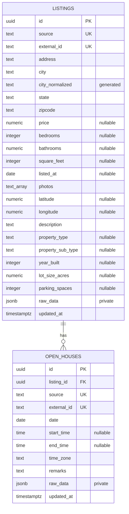

# Database (ERD and data dictionary)

Source of truth: the [Drizzle schema](../backend/src/platform/db/schema.ts) and the
[versioned migrations](../backend/db/migrations/). The database has two business tables,
`listings` and `open_houses`, plus the `_idx_migrations` bookkeeping table.

`UK` on source/external ID denotes a **composite** unique constraint in each table, not uniqueness of either column alone. Every open house belongs to one listing. A listing can have zero or many open houses; the foreign key uses `ON DELETE CASCADE`.

## Listings

| Fields                                | PostgreSQL representation                | Meaning                                                                          |
| ------------------------------------- | ---------------------------------------- | -------------------------------------------------------------------------------- |
| `id`                                  | UUID, generated primary key              | Stable internal identity used by detail URLs and foreign keys.                   |
| `source`, `external_id`               | Nonempty text, composite unique          | Source identity for idempotent imports. An MLS ID is not the internal UUID.      |
| `address`, `city`, `state`, `zipcode` | Non-null text, default empty             | Empty means unavailable. ZIP stays text to preserve leading zeroes and ZIP+4.    |
| `city_normalized`                     | Generated text                           | `lower(btrim(city))`, supporting case-insensitive exact city lookup.             |
| `price`                               | Nullable numeric(14,2), nonnegative      | Price in USD; null is unknown, not zero.                                         |
| `bedrooms`                            | Nullable nonnegative integer             | Zero may represent a studio; null is unavailable.                                |
| `bathrooms`                           | Nullable numeric(5,1), nonnegative       | Fractional bathrooms such as 2.5.                                                |
| `square_feet`                         | Nullable nonnegative integer             | Living area in square feet. Price/sqft requires a positive price and area.       |
| `listed_at`                           | Nullable date                            | Calendar listing date, not a UTC timestamp.                                      |
| `photos`                              | Non-null text array, default empty       | Ordered public image URLs. An empty list or failed image gets a UI fallback.     |
| `latitude`, `longitude`               | Nullable numeric(18,15) / numeric(19,15) | Ranges -90..90 and -180..180. A map requires both.                               |
| `description`                         | Non-null text, default empty             | Displayed as text, not injected HTML.                                            |
| `property_type`, `property_sub_type`  | Nullable text                            | Source classifications as supplied. The API derives `homeType` from the subtype. |
| `year_built`                          | Nullable integer, 1..9999                | Construction year when supplied.                                                 |
| `lot_size_acres`                      | Nullable numeric(14,4), nonnegative      | Lot size in acres.                                                               |
| `parking_spaces`                      | Nullable nonnegative integer             | Parking count when supplied.                                                     |
| `raw_data`                            | Non-null JSONB                           | Original source material for import diagnostics; excluded from the public API.   |
| `updated_at`                          | Timestamp with timezone                  | Persistence/import update time; not an assertion of current market availability. |

## Open houses

| Fields                   | Representation                  | Meaning                                                                                |
| ------------------------ | ------------------------------- | -------------------------------------------------------------------------------------- |
| `id`, `listing_id`       | UUID primary / foreign key      | Internal event identity and its parent listing.                                        |
| `source`, `external_id`  | Nonempty text, composite unique | Idempotent source identity.                                                            |
| `date`                   | Required date                   | Event calendar date at the property.                                                   |
| `start_time`, `end_time` | Nullable time without timezone  | Local wall-clock values; missing times remain unavailable.                             |
| `time_zone`              | Required nonempty text          | IANA zone supplied by the seed or import configuration, such as `America/Los_Angeles`. |
| `remarks`                | Non-null text, default empty    | Event notes.                                                                           |
| `raw_data`, `updated_at` | JSONB / timestamptz             | Private source material and persistence update time.                                   |

The browser compares the event date and end time with the current date and time **in the event's
zone** to label an event as past, today or upcoming. See [Business rules](business-rules.md#8-open-houses).

## Indexes

| Index                                   | Columns                                                          | Supports                              |
| --------------------------------------- | ---------------------------------------------------------------- | ------------------------------------- |
| `listings_source_external_id_unique`    | `(source, external_id)` unique                                   | Idempotent import and seed upserts    |
| `listings_city_normalized_idx`          | `city_normalized`                                                | Exact city filter                     |
| `listings_city_prefix_idx`              | `city_normalized text_pattern_ops`                               | City suggestions (`LIKE 'prefix%'`)   |
| `listings_home_type_idx`                | `regexp_replace(lower(property_sub_type), '[^a-z0-9]', '', 'g')` | Home-type filter across spellings     |
| `listings_zipcode_idx`                  | `zipcode`                                                        | ZIP filter                            |
| `listings_price_id_idx`                 | `(price ASC NULLS LAST, id)`                                     | Price sort                            |
| `listings_listed_at_id_idx`             | `(listed_at DESC NULLS LAST, id)`                                | Default sort (newest listed)          |
| `open_houses_source_external_id_unique` | `(source, external_id)` unique                                   | Idempotent upserts                    |
| `open_houses_listing_date_time_idx`     | `(listing_id, date, start_time, id)`                             | Open houses for one listing, in order |

Square-feet and bedroom sorts have no dedicated index; add one only if a measured query plan
shows the need.

## Constraints

Check constraints reject empty `source`, `external_id` and `time_zone` values; negative price,
bedrooms, bathrooms, square feet, lot size and parking; a year built outside 1–9999; and
coordinates outside their ranges. Unknown values are stored as `NULL`, never as zero.

## Migrations

| File                                | Change                                                      |
| ----------------------------------- | ----------------------------------------------------------- |
| `0001_listings_and_open_houses.sql` | Tables, generated city column, constraints and base indexes |
| `0002_listing_search_options.sql`   | Home-type expression index and city prefix index            |

`npm run db:migrate` applies pending files in name order inside one transaction protected by an
advisory lock, and records each file's SHA-256 checksum in `_idx_migrations`. An applied file must
never be edited; a changed checksum stops the run. Schema changes always go in a new numbered
file.

## Access rules

- The API only reads. The seed and import scripts are the only writers.
- `raw_data` is selected by no API query.
- `homeType` in API responses is derived from `property_sub_type` at read time; it is not stored.
- Home-type choices and city suggestions are computed from the whole inventory, independent of
  the visitor's other filters.
